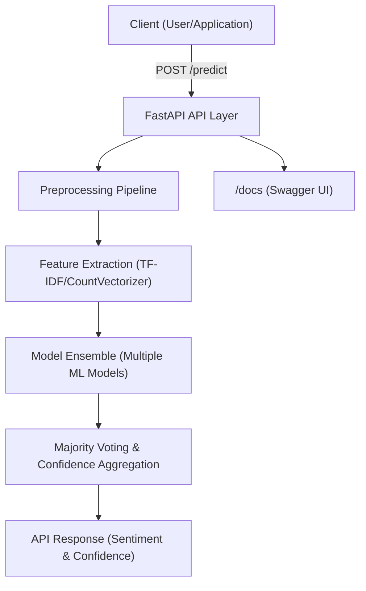

# Arabic/English Sentiment Analysis API


## Project Overview

A collaborative sentiment analysis project that classifies reviews written in **Arabic, English, or emoji only** as **positive**, **negative**, or **neutral**. It is designed to predict the sentiment of text data using a variety of machine learning models, plus custom CNN and Bidirectional LSTM deep learning models. The project aims to provide robust, accurate, and scalable sentiment analysis APIs for both English and Arabic text, leveraging ensemble learning and advanced preprocessing techniques. The system is designed for extensibility, allowing easy integration of new models and preprocessing steps. The target audience includes data scientists, NLP researchers, software engineers, and organizations seeking to integrate advanced sentiment analysis into their products or research workflows. The project emphasizes teamwork, code quality, and reproducibility, with a focus on real-world applicability and multilingual support.

## Key Features

- **RESTful API** for sentiment prediction using FastAPI, providing easy integration with other applications.
- **Ensemble learning** with multiple models (Random Forest, XGBoost, CatBoost, LightGBM, Decision Tree, GaussianNB, Logistic Regression, SVC, MultinomialNB) for improved accuracy and robustness.
- **Multilingual support**: Handles both English and Arabic text, with language detection and normalization.
- **Advanced text preprocessing**: Includes normalization, lemmatization, emoji handling, negation handling, and language detection for high-quality feature extraction.
- **Confidence scoring**: Each prediction is accompanied by a confidence score, aiding downstream decision-making.
- **Health check endpoint**: For easy monitoring and integration with deployment pipelines.
- **Modular and extensible codebase**: Easily add new models, preprocessing steps, or API endpoints.
- **OpenAPI/Swagger documentation**: Auto-generated, interactive API docs for rapid prototyping and testing.
- **Collaborative dataset management**: Datasets and preprocessing pipelines are designed for team-based workflows and reproducibility.

## Project Architecture



- **API Layer:** FastAPI serves as the main entry point, handling requests, validation, and routing.
- **Preprocessing Pipeline:** Cleans, normalizes, and tokenizes input text, supporting both English and Arabic, and handling emojis and negations.
- **Feature Extraction:** Converts text to numerical features using TF-IDF or CountVectorizer, supporting multiple model requirements.
- **Model Ensemble:** Multiple models make independent predictions; results are aggregated using majority voting and confidence averaging.
- **Response Layer:** Returns the final sentiment label and confidence score in a standardized JSON format.
- **Documentation:** Interactive API documentation is available at `/docs` for testing and exploration.

## Tech Stack

- **Programming Language:** Python 3.8+
- **Web Framework:** FastAPI (ASGI, OpenAPI/Swagger support)
- **Machine Learning:**
  - scikit-learn (Logistic Regression, SVC, MultinomialNB, Random Forest, Decision Tree, GaussianNB)
  - xgboost (XGBoost)
  - catboost (CatBoost)
  - lightgbm (LightGBM)
- **NLP & Preprocessing:**
  - nltk (stopwords, lemmatization)
  - textblob (spelling correction)
  - emoji (emoji normalization)
  - pandas (data handling)
- **Serialization & Utilities:**
  - joblib (model persistence)
  - numpy (numerical operations)
- **Testing:** pytest (recommended), unittest
- **Documentation:** Markdown, OpenAPI/Swagger (auto-generated)
- **Deployment:** Uvicorn (ASGI server), Docker (optional for containerization)

## Installation Guide

1. **Clone the repository:**
   ```bash
   git clone https://github.com/HasanMajed/sentiment-analysis.git
   cd sentiment-analysis
   ```

2. **Create and activate a virtual environment:**
   ```bash
   python -m venv venv
   # On Unix/macOS:
   source venv/bin/activate
   # On Windows:
   venv\Scripts\activate
   ```

3. **Install dependencies:**
   ```bash
   pip install -r requirements.txt
   ```
   If `requirements.txt` is missing, install the main dependencies manually:
   ```bash
   pip install fastapi uvicorn scikit-learn xgboost catboost lightgbm nltk textblob emoji pandas joblib numpy
   ```

4. **Download NLTK data (if not auto-downloaded):**
   ```python
   python
   >>> import nltk
   >>> nltk.download('stopwords')
   >>> nltk.download('wordnet')
   >>> nltk.download('omw-1.4')
   ```

5. **Ensure model files are present in the `models/` directory.**
   - If you need to retrain models, use the provided notebooks or scripts in the `notebooks/` or `app/` directories.

6. **(Optional) Run with Docker:**
   - Build and run the container:
     ```bash
     docker build -t sentiment-analysis .
     docker run -p 8000:8000 sentiment-analysis
     ```

## Usage Instructions

1. **Run the API server:**
   ```bash
   uvicorn app.best_api:app --reload
   ```
   Or for other APIs:
   ```bash
   uvicorn app.tfid-api:app --reload
   uvicorn app.countapi:app --reload
   ```
   - The server will start at [http://localhost:8000](http://localhost:8000)

2. **Access the API documentation:**
   - Open [http://localhost:8000/docs](http://localhost:8000/docs) in your browser for interactive Swagger UI.
   - Use [http://localhost:8000/redoc](http://localhost:8000/redoc) for alternative documentation (if enabled).

3. **Example API Request:**
   - Using `curl`:
     ```bash
     curl -X POST "http://localhost:8000/api/v1/text-analysis" -H "Content-Type: application/json" -d '{"text": "I love this app!"}'
     ```
   - Using Python:
     ```python
     import requests
     response = requests.post("http://localhost:8000/api/v1/text-analysis", json={"text": "I love this app!"})
     print(response.json())
     ```

4. **API Endpoints:**
   - See the API Reference section below for all available endpoints and their usage.

## API Reference

### Health Check

- **GET** `/api/v1/health`
  - **Description:** Check if the API is running.
  - **Response:** `{ "status": "API is running" }`

### Sentiment Prediction

- **POST** `/api/v1/text-analysis`
  - **Description:** Predict sentiment using the best ensemble model.
  - **Request Body:**
    ```json
    { "text": "Your review here" }
    ```
  - **Response:**
    ```json
    { "sentiment": "positive", "confidence": 0.94 }
    ```

- **POST** `/api/v1/batch-analysis`
  - **Description:** Predict sentiment in bulk, by taking a csv file with a text column.
  - **Request Body:** `multipart/form-data` (CSV file upload)

- **`/api/v1/text-analysis`** accepts a JSON body with a `text` field and returns the predicted sentiment and confidence score.
- **`/api/v1/batch-analysis`** accepts a CSV file.
- **Interactive documentation** is available at `/docs`.

## Environment Variables

- No explicit environment variables are required for basic operation.
- Ensure the following directories exist:
  - `models/` (for model files)
  - `data/` (for datasets)
- If deploying in production, you may wish to set environment variables for:
  - `PORT` (default: 8000)
  - `ENV` (e.g., `development`, `production`)
  - `LOG_LEVEL` (e.g., `info`, `debug`)
- For advanced configuration, see deployment documentation or Dockerfile (if available).

## Testing Guide

- **Recommended:** Use `pytest` for running tests. If you add tests, place them in a `tests/` directory.
- **To run all tests:**
  ```bash
  pytest
  ```
- **To run a specific test file:**
  ```bash
  pytest tests/test_api.py
  ```
- **Manual testing:**
  - Use the `/docs` Swagger UI to manually test endpoints.
  - Use `curl` or Postman for custom requests.
- **Test coverage:**
  - Ensure all endpoints and major code paths are covered by tests.
  - Add tests for edge cases, invalid input, and error handling.

## Contribution Guidelines

We welcome contributions from all team members and the community!

1. **Fork the repository** and create your branch from `main`.
2. **Write clear, well-documented code** and add or update tests as needed.
3. **Run all tests** before submitting a pull request.
4. **Submit a pull request** with a clear description of your changes and reference any related issues.
5. **Participate in code reviews** and respond to feedback promptly.
6. **Follow PEP8** style guidelines for Python code.
7. **Respect the collaborative nature** of the project - discuss major changes with the team before implementation.

## License

This project is licensed under the MIT License. You are free to use, modify, and distribute this software with attribution.

## Acknowledgments

- Thanks to all contributors and the InnoSoft team for their collaboration, support, and feedback throughout the project.
- Inspired by open-source sentiment analysis and NLP research communities.
- Special thanks to the maintainers of FastAPI, scikit-learn, and the open-source libraries that made this project possible.
- Appreciation to those who contributed datasets, documentation, and testing support.

## Team Members

- **Ghala Alroumaih** <ghala.alroumaih@innosoft.sa>
  - Led the design, training, and optimization of the **Logistic Regression** sentiment model.
  - Led the development and implementation of the **SGD Classifier** with hyperparameter tuning.
  - Co-developed the **Support Vector Classifier (SVC)** model, focusing on feature engineering and validation.
  - Implemented and fine-tuned the **SGD Classifier** model for efficient large-scale text classification.
  - Co-developed the **Stacking Classifier** ensemble method in collaboration with Jory Alshathri.
  - Contributed to model integration and API endpoint design for logistic regression, SVC, and SGD
  - *Work supported by dataset preparation and preprocessing was collaborative work.*

- **Jory Alshathri** <jory.alshathri@innosoft.sa>
  - Led the implementation and fine-tuning of the **Multinomial Naive Bayes (MultinomialNB)** model for text sentiment classification.
  - Led the development and hyperparameter optimization of the **K-Nearest Neighbors (KNN)** classifier with randomized search.
  - Co-developed the **Support Vector Classifier (SVC)** model, focusing on feature engineering and validation.
  - Developed and maintained preprocessing pipelines for text normalization and tokenization.
  - Led the implementation and fine-tuning of the Stacking model.
  - Implemented and optimized the **K-Nearest Neighbors (KNN)** classifier for sentiment analysis.
  - Co-developed the **Stacking Classifier** ensemble method in collaboration with Ghala Alroumaih.
  - *Work supported by dataset preparation and preprocessing was collaborative work.*

- **Saud Alhathlool** <saud.alhathlool@innosoft.sa>
  - Designed and implemented the ensemble system, integrating multiple models for robust sentiment prediction.
  - Responsible for the development, training, and deployment of:
    - **Random Forest**
    - **XGBoost**
    - **CatBoost**
    - **LightGBM**
    - **Decision Tree**
    - **GaussianNB**
  - Developed the majority voting mechanism and confidence scoring logic.
  - Maintained model serialization and loading infrastructure.
  - *Work supported by dataset preparation and preprocessing was collaborative work.*

- **Hasan Alhalees** <hasan.alhalees@innosoft.sa>
  - Led the development and implementation of the **CNN-Based Sentiment Classification** model.
  - Designed and built custom Convolutional Neural Network architecture from scratch using TensorFlow/Keras.
  - Implemented multi-kernel 1D CNN with parallel convolutional blocks and advanced regularization techniques.
  - Developed comprehensive training pipeline with noise injection for robust generalization.
  - *Work supported by dataset preparation and preprocessing was collaborative work.*

- **Nada Alghamdi** <nada.alghamdi@innosoft.sa>
  - Led the development and implementation of the **LSTM-Based Sentiment Classification** model.
  - Designed and built custom Bidirectional LSTM architecture from scratch using TensorFlow/Keras.
  - Implemented advanced regularization techniques including layer normalization and L2 regularization.
  - Developed comprehensive evaluation pipeline with focus on realistic performance metrics.
  - *Work supported by dataset preparation and preprocessing was collaborative work.*

- **Mahi Kamaleldin** <mahi@innosoft.sa>
  - Developed and executed test cases for API endpoints and model predictions.
  - Automated regression testing and monitored model performance.
  - Provided feedback on usability and robustness of the API.
  - *Work supported by dataset preparation and preprocessing was collaborative work.*

---

# Additional Technical Documentation

## **Hasan Alhalees** - CNN Technical Details
### CNN-Based Sentiment Classification

This project implements a custom Convolutional Neural Network (CNN) for sentiment classification of multilingual text reviews (Arabic, English, and Emoji). The approach balances modular design, experimental flexibility, and practical accuracy - targeting real-world use cases with a focus on clarity, noise robustness, and class distinction.

#### Project Overview

The goal is to classify reviews into **positive**, **negative**, or **neutral** categories. The system processes both Arabic and English content, including support for emoji-only inputs. The model was developed from scratch using TensorFlow/Keras, with fine control over architectural and training parameters.

#### Model Architecture

  The `SentimentCNN` class encapsulates the entire model. It is a **multi-kernel 1D CNN** architecture with key modern enhancements:

  - **Embedding Layer**:
    - Converts token sequences into dense vector embeddings.
    - Supports pre-padding up to `max_length`.

  - **Parallel Convolutional Blocks**:
    - Multiple `Conv1D` layers with varying kernel sizes (default: `[3, 4, 5]`).
    - Each block uses ReLU activation and batch normalization.

  - **Optional Extra Convolutional Layer**:
    - Deeper feature abstraction with configurable kernel size and filters.
    - Optional residual connections to promote gradient flow.

  - **Pooling**:
    - Global Max Pooling is used to compress feature maps.

  - **Classification Head**:
    - Fully connected `Dense` layer with dropout.
    - Output layer with softmax activation (3 classes).

  ##### Customization Parameters

  - `kernel_sizes`, `num_filters`, `dropout_rate`
  - `extra_conv_layer` and `residual_connection` options
  - Configurable optimizer and learning rate

#### Methodology

  The overall approach was structured into five major stages:

  ##### 1. Preprocessing
  - Custom normalization routines for Arabic and English.
  - Emoji detection and language tagging (`lang` column includes 'emoji').
  - Tokenization using `Tokenizer` (Keras) with fixed vocabulary size.
  - Padding with uniform `max_length` derived from EDA.

  ##### 2. Architecture Design
  - Architecture was written from scratch in OOP-style (`SentimentCNN`).
  - Designed to allow experimental toggles for architectural variants (residuals, extra conv, etc.).
  - Each design choice (e.g., kernel sizes, dropout) was tested iteratively.

  ##### 3. Training Strategy
  - Optimizer: Adam (default), with `ReduceLROnPlateau` and `EarlyStopping` callbacks.
  - Loss: `categorical_crossentropy` (multiclass softmax).
  - Stratified train/val split using `train_test_split` from `sklearn`.

  ##### 4. Evaluation
  - Evaluated using:
    - Confusion matrix
    - Precision, recall, F1-score
  - Care was taken to assess performance on each class, especially **neutral** due to class imbalance and potential noise.

  ##### 5. Noise Injection
  To avoid "too perfect" performance - especially on the neutral class - controlled noise was added to the neutral dataset. This helped simulate real-world uncertainty and avoid overfitting.

#### Results Summary

  - Achieved realistic class separation with minimal overfitting.
  - Final performance (after noise tuning) reflects robustness, especially in real-world neutral sentiment.
  - Recall and precision were brought closer to realistic levels (as opposed to inflated 100% metrics on idealized data).

#### How to Run

  1. **Install Dependencies**
    ```bash
    pip install tensorflow scikit-learn pandas matplotlib
    ```

  2. **Run Training**
    - Open `notebooks/deep-learning/cnn.ipynb`
    - Set dataset path and parameters
    - Run all cells

  3. **Tuning Options**
    - Modify `SentimentCNN(...)` instantiation to try different architectural setups.

#### Key Takeaways

  - Custom CNN models can compete with transformer-based methods when well-designed for specific tasks.
  - Attention to noise, overfitting, and architecture flexibility is essential.
  - Don’t blindly trust high accuracy — always validate with realistic, noisy inputs.

---

## **Nada Alghamdi** - LSTM Technical Details
### LSTM-Based Sentiment Classification

This repository contains a custom implementation of a deep **Bidirectional LSTM model** for sentiment analysis. The model classifies multilingual reviews - including Arabic, English, and emoji-only entries - into **positive**, **negative**, or **neutral** categories. The architecture is designed to effectively capture the temporal and contextual patterns in the text, while minimizing overfitting and maximizing generalization.

#### Project Overview

The LSTM model is part of a broader sentiment analysis pipeline. It was trained using a carefully preprocessed and balanced dataset. The architecture was tuned to improve generalization and ensure realistic accuracy metrics - especially on the **neutral** class, which often suffers in multiclass classification.

#### Model Architecture

  The `SentimentLSTM` class defines the architecture from scratch using TensorFlow/Keras. Below is a breakdown of the model:

  ##### Core Components

  - **Embedding Layer**:
    - Converts tokenized input into dense vector representations.
    - Configurable `vocab_size` and `embedding_dim`.

  - **Bidirectional LSTM Layers**:
    - Two stacked `Bidirectional(LSTM)` layers capture both forward and backward dependencies.
    - The first LSTM layer returns sequences; the second outputs a fixed-length vector.

  - **Normalization & Regularization**:
    - `LayerNormalization` after each LSTM block.
    - `Dropout` applied to reduce overfitting.
    - `L2 regularization` in dense layers for additional control over complexity.

  - **Dense Layers**:
    - Two fully connected layers with ReLU activation.
    - Final softmax output layer for 3-class classification.

  ##### Tunable Hyperparameters

  - `lstm_units`, `dropout_rate`, `l2_rate`
  - `learning_rate`, `embedding_dim`, `input_length`

#### Methodology

  The modeling approach follows a practical deep learning pipeline:

  ##### 1. Data Preparation
  - Texts were normalized based on language-specific rules.
  - Labels were encoded using `LabelEncoder` and converted via `to_categorical`.
  - Tokenization and padding were handled using a fixed `input_length`.

  ##### 2. Model Design
  - The architecture was built to capture both short- and long-range dependencies.
  - Bidirectional layers were chosen to improve understanding of context in both directions.
  - Layer normalization was applied post-LSTM for training stability.

  ##### 3. Training Strategy
  - Optimizer: `Adam` with `ReduceLROnPlateau` to handle learning rate decay.
  - Loss: `categorical_crossentropy`.
  - Early stopping was employed to prevent overfitting.
  - Class weights can be computed using `compute_class_weight()` to handle imbalance.

  ##### 4. Evaluation
  - Evaluation includes accuracy, precision, recall, F1-score, and confusion matrix.
  - Special care was given to analyzing false positives in neutral and negative classes.

  ##### 5. Realism via Noise
  To reduce the effect of overly-clean neutral data, the dataset included noise samples (e.g., ambiguous phrases, emoji-only text). This ensured that the model didn't "memorize" the dataset but instead learned more robust generalizations.

#### Results Summary

  - The final model shows a realistic performance with generalization on unseen data.
  - Overfitting was minimized through dropout, regularization, and early stopping.
  - Balanced performance across all three classes, avoiding inflation in accuracy metrics.

#### How to Run

  1. **Install Dependencies**
    ```bash
    pip install tensorflow scikit-learn pandas matplotlib
    ```

  2. **Train the Model**
    - Open `notebooks/deep-learning/lstm.ipynb`
    - Set dataset paths and parameters
    - Run all cells

  3. **Modify Parameters**
    - You can adjust the LSTM size, dropout, or learning rate in the `SentimentLSTM(...)` constructor.

#### Final Notes

  This implementation emphasizes **model stability**, **realism**, and **interpretability**. The use of BiLSTMs with normalization and controlled regularization gives strong results without relying on transformers or external embeddings.
